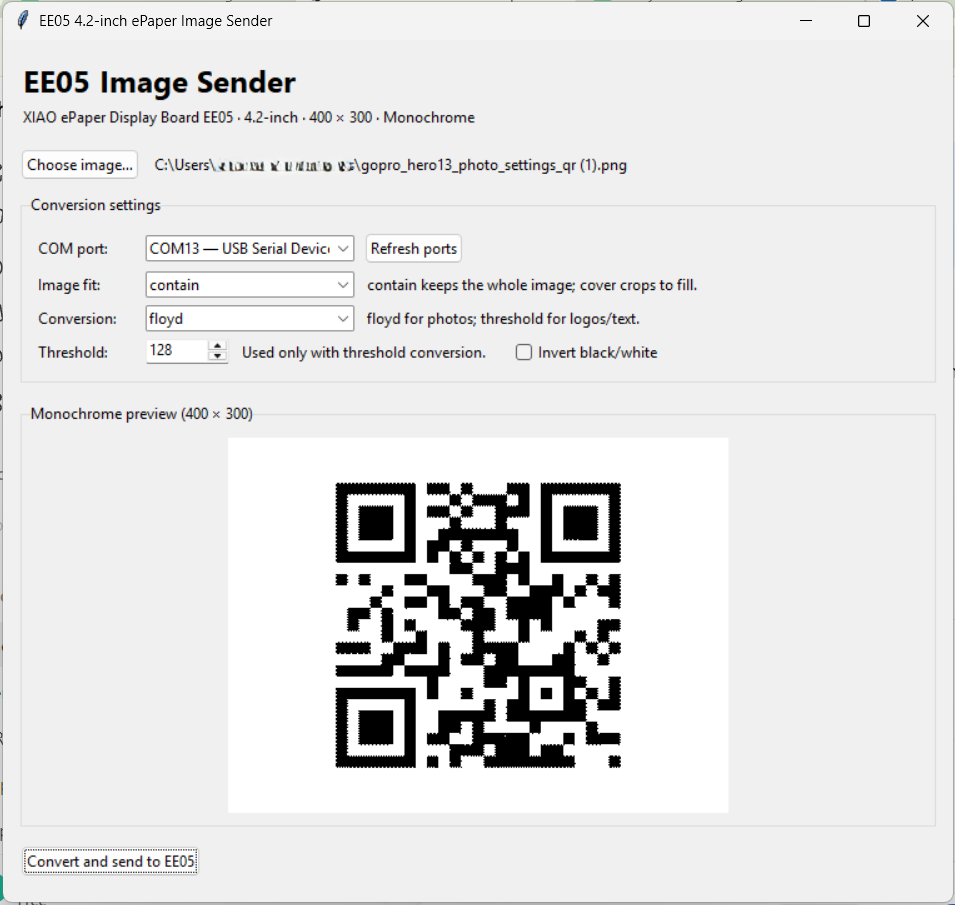
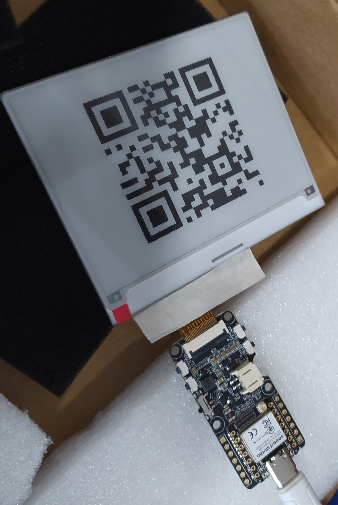
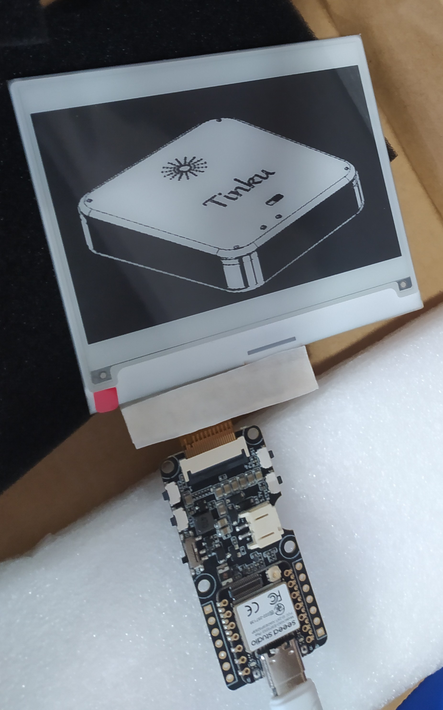

# EE05 4.2-inch e-Paper Image Sender

A desktop utility and ESP32 firmware solution to convert and display any image on a **4.2-inch monochrome e-Paper display ($400 \times 300$)** driven by the **Seeed Studio XIAO ePaper Display Board (EE05)**.

Instead of converting images into C arrays and recompiling firmware every time you want to change the screen, you **flash the receiver firmware once** and use the Python desktop app to push new images over USB Serial in seconds.

---

## Preview & Hardware Demo

| Desktop Application (`ee05_image_app.py`) | e-Paper Output (QR Code) | e-Paper Output (Custom Graphic) |
| :---: | :---: | :---: |
|  |  |  |

---

## Features

- **No Firmware Rebuilds Required:** Flash the ESP32-S3 board once via PlatformIO, then upload unlimited images directly from your PC.
- **Broad Image Format Support:** Opens `.png`, `.jpg`, `.jpeg`, `.bmp`, `.gif` (first frame), `.tif`, `.tiff`, and `.webp` files, automatically handling EXIF orientation and compositing transparency onto a white background.
- **Flexible Scaling & Fit Modes:**
  - `contain`: Fits the entire image inside $400 \times 300$ with white padding.
  - `cover`: Scales and center-crops the image to fill the entire display.
  - `stretch`: Resizes directly to $400 \times 300$.
- **Monochrome Conversion Options:**
  - **Floyd-Steinberg Dithering (`floyd`):** Ideal for photographs and gradients.
  - **Threshold (`threshold`):** Configurable cutoff ($1\text{--}255$) for crisp logos, text, and QR codes.
  - **Invert Black/White:** One-click color inversion.
- **Live Preview:** Inspect the exact $400 \times 300$ 1-bit rendering before sending it to the board (automatically saved to `assets/last_image_preview.png`).
- **Reliable Serial Protocol:** Uses a binary header (`EIMG`), CRC32 integrity verification, and 128-byte acknowledged (`ACK`) chunks to prevent USB CDC buffer overruns on the ESP32-S3.

---

## Hardware Requirements

- **Controller Board:** Seeed Studio XIAO ePaper Display Board (EE05) with XIAO ESP32-S3
- **Display:** 4.2-inch Monochrome e-Paper Panel ($400 \times 300$ resolution)
- **Cable:** USB-C data cable

---

## Repository Structure

```text
├── src/
│   ├── main.cpp                 # ESP32-S3 serial receiver & display refresh firmware
│   └── driver.h                 # e-Paper pinout & display driver configuration
├── assets/
│   └── last_image_preview.png   # Auto-generated preview of the last converted image
├── ee05_image_app.py            # Python Tkinter GUI for image conversion & serial upload
├── platformio.ini               # PlatformIO build configuration
├── requirements.txt             # Python dependencies (Pillow, PySerial)
└── README.md
```

---

## Getting Started

### 1. Flash the Firmware (One-Time Setup)

1. Open the project folder in **VS Code** with the **PlatformIO IDE** extension installed.
2. Connect the EE05 board to your PC via USB-C.
3. Build and upload the firmware (`main.cpp` and `driver.h`) to the board.
4. Once uploaded, **close the PlatformIO Serial Monitor** so the COM port is free for the Python application.

### 2. Install Python Dependencies

Ensure you have Python 3.9+ installed (with `tkinter` enabled), then install the required packages:

```bash
python -m pip install pillow pyserial
```
*(Or if you include a `requirements.txt` file: `python -m pip install -r requirements.txt`)*

### 3. Run the Desktop Image Sender

Launch the GUI from your terminal:

```bash
python ee05_image_app.py
```

1. Click **Choose image…** and select any image file from your computer.
2. Select your board's **COM port** (click **Refresh ports** if needed).
3. Adjust **Image fit**, **Conversion** mode (`floyd` or `threshold`), **Threshold**, or **Invert black/white** while viewing the live preview.
4. Click **Convert and send to EE05** and wait for the e-Paper screen to complete its refresh cycle.

---

## Serial Transfer Protocol Overview

For developers looking to extend the firmware or build custom host scripts, the PC and EE05 communicate at **115,200 baud** using the following handshake:

1. **Ready Signal:** Firmware periodically broadcasts `EE05_READY`.
2. **Header Packet (16 bytes, little-endian `<4sHHII`):**
   - Magic bytes: `EIMG`
   - Width: `400` (`uint16`)
   - Height: `300` (`uint16`)
   - Payload size: `15000` bytes (`uint32`, 1-bit MSB-first packed bitmap)
   - Checksum: `CRC32` of the payload (`uint32`)
3. **Chunked Transfer:** Firmware replies `RECEIVING_IMAGE`. The host sends the $15,000$-byte bitmap in `128`-byte chunks, waiting for `ACK:<offset>` after each block.
4. **Display Refresh:** Once CRC32 validation passes, the display updates and the firmware responds with `DISPLAYED`.
